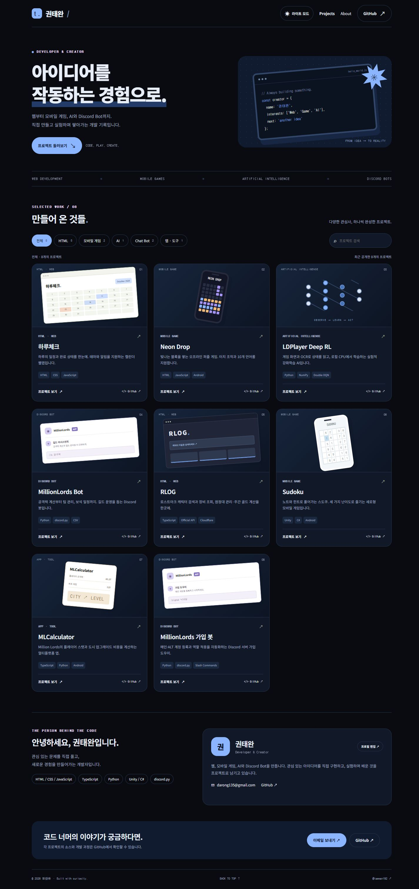
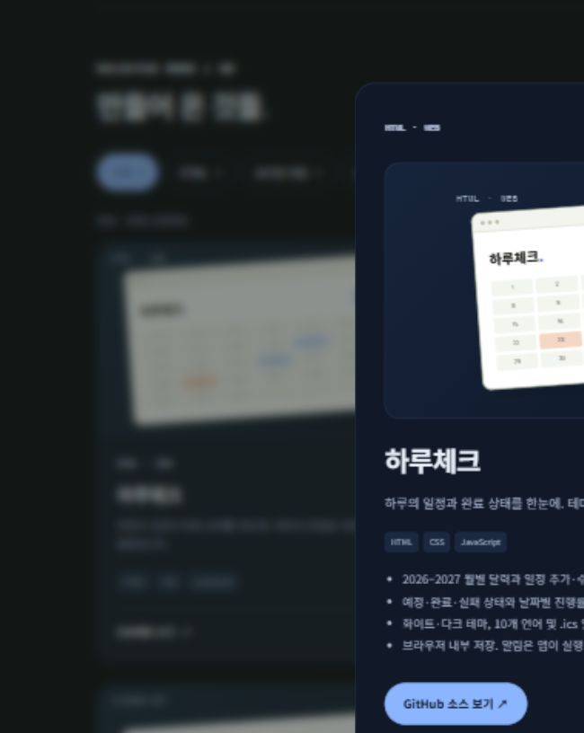

# 권태완 개인 포트폴리오

웹, 모바일 게임, AI, Discord Bot 프로젝트를 소개하는 개인 홈페이지입니다. 블랙·다크블루 다크 모드와 라이트 모드를 지원합니다.

`index.html`을 브라우저에서 바로 열면 됩니다. 외부 패키지·빌드·서버·API 키가 필요하지 않습니다.

## 포함 기능

- 전체 / HTML / 모바일 게임 / AI / Chat Bot / 앱·도구 필터
- 프로젝트 이름·설명·기술 검색, 필터와 검색 동시 적용
- 프로젝트별 상세 모달, 실제 GitHub 저장소 링크
- 상세 화면은 해당 프로젝트의 썸네일을 위에, 제목·설명·주요 기능을 아래에 표시
- PC·태블릿·모바일 반응형, 키보드 접근과 Escape로 모달 닫기
- 프로젝트 카드의 제목·본문·이미지를 누르거나 제목을 키보드로 선택해 상세 보기
- 라이트·다크 모드 전환 및 브라우저별 설정 저장, 첫 방문 시 시스템 테마 반영
- 이름·이메일·직함·자기소개 프로필 편집과 수정한 HTML 다운로드

## 내용 수정

하단 프로필 카드의 `프로필 편집`에서 정보를 바꿀 수 있습니다. `이 브라우저에 저장`은 현재 브라우저에만 적용되며 다른 방문자의 화면을 바꾸지 않습니다. `수정한 HTML 다운로드`는 프로필을 기본값으로 포함한 독립 HTML을 만듭니다. 그 파일을 다른 기기에서 열거나 호스팅에 배포하면 변경한 기본 프로필을 볼 수 있습니다.

기본 이름은 권태완, 이메일은 darong135@gmail.com입니다. 원본의 `profile-defaults` JSON에서 기본 정보를 직접 수정해도 됩니다. 테마와 프로필은 localStorage에 저장하며, 저장이 제한된 환경에서도 현재 화면 수정과 HTML 다운로드는 가능합니다.

`index.html` 안의 `PROJECTS` 배열에서 프로젝트를 편집하세요. `categories`에는 `html`, `mobile`, `ai`, `chatbot`, `tools`를 여러 개 지정할 수 있습니다. 카테고리 숫자는 자동 계산됩니다. 설명과 세부 기능은 2026-10-22에 확인한 각 저장소 README를 바탕으로 작성했으며 카드 그래픽은 실제 화면 캡처가 아닌 프로젝트별 그래픽입니다.

현재 연결: 하루체크, Neon Drop, LDPlayer Deep RL, MillionLords Bot, RLOG, Sudoku, MLCalculator, MillionLords 가입 봇. MLCalculator는 웹 버전이 있어 HTML과 앱·도구 양쪽으로 분류했습니다. Neon Drop은 HTML로도 실행되지만 모바일 게임 분류로 지정했습니다.

GitHub 계정: https://github.com/taewan192

Figma 디자인: https://www.figma.com/design/n90EzWm0ST8mqAI29SAskq

Figma의 디자인 화면과 HTML 소스는 각각 수정하는 파일이며 자동 동기화되지 않습니다. 현재 Sites 미리보기는 소유자만 열 수 있는 비공개 배포입니다.

## 저장소 구성

- `index.html`: HTML·CSS·JavaScript와 프로젝트 데이터가 포함된 독립 실행 파일
- `docs/preview.jpg`: 블랙·다크블루 테마 미리보기

이 저장소의 파일을 올리는 것만으로 GitHub Pages가 활성화되지는 않습니다. 파일을 내려받아 직접 열거나 정적 호스팅에 배포할 수 있습니다.

## 프로젝트 상세 화면

